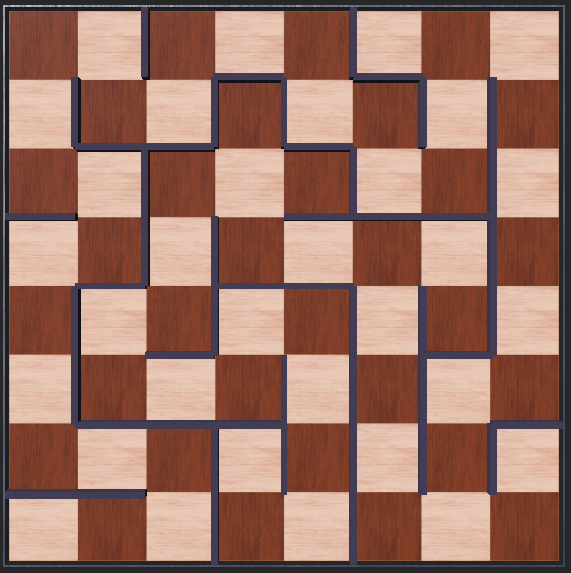

# Webots Maze Generator

Procedural $N \times M$ maze generator and parser for **Webots (R2025a)**. Generates synchronized `.wbt` simulation worlds (with collinear walls merged for fast rendering) and metadata-rich `.json` adjacency graphs ready for classical pathfinding benchmarks (**BFS, DFS, Dijkstra, A***).



---

## Features

- **Solvable Perfect Mazes:** Uses iterative Randomized Depth-First Search (Recursive Backtracker) so every cell is reachable and large grid dimensions (e.g., `50x50`) generate without hitting recursion limits.
- **Optimized Webots Worlds:** Merges contiguous collinear wall segments into single `Wall` nodes and aligns `0.4m` cells cleanly with `0.8m x 0.8m` chequered floor tiles.
- **Enriched JSON Maps:** Stores the bidirectional adjacency dictionary alongside arena bounds, cell size, dead-end locations, and exact `[row, col]` + Webots `[x, y]` start/goal coordinates.
- **Reverse `.wbt` Parser:** Includes a parser (`build_graph_from_wbt`) to extract graph maps from existing hand-built Webots `.wbt` worlds.
- **Zero External Dependencies:** Built entirely with the Python 3.8+ standard library.

---

## Repository Structure

```text
webots-maze-generator/
├── README.md
├── LICENSE
├── requirements.txt
├── .gitignore
├── generate.py                # Command-line entry point
├── maze_gen/
│   ├── __init__.py
│   ├── generator.py           # Randomized DFS maze generation & dead-end detection
│   ├── exporters.py           # Writers for .wbt worlds and enriched .json graphs
│   ├── parser.py              # Reverse parser: .wbt -> Python adjacency graph
│   └── visualizer.py          # Top-down ASCII terminal renderer
├── examples/                  # Pre-generated sample worlds and JSON graphs
└── tests/
    └── test_generator.py      # Solvability & .wbt <-> .json round-trip tests
```

---

## Quick Start

### 1. Generate with Default Settings

Running `generate.py` with no arguments uses sensible defaults (`8x8` grid, `0.4m` cells aligned to `0.8m` chequered floor tiles, random layout) and outputs to `examples/`:

```bash
python generate.py
```

### 2. Generate with Custom Dimensions & Seed

Customize grid dimensions, random seed (for reproducible algorithm comparisons), cell size, or output directory:

```bash
python generate.py --rows 8 --cols 8 --seed 42 --out-dir examples
```

**Available CLI options:**

| Option | Description | Default |
|---|---|---|
| `--rows` | Number of maze rows | `8` |
| `--cols` | Number of maze columns | `8` |
| `--cell-size` | Width/length of each cell in meters | `0.4` |
| `--seed` | Integer seed for deterministic maze layouts | Random |
| `--out-dir` | Target output folder | `examples` |
| `--name` | Custom base filename without extension | `maze_<rows>x<cols>` |
| `--quiet` | Suppress the terminal ASCII preview | `False` |

### 3. Run Unit Tests

Verify maze solvability and `.wbt` ↔ `.json` round-trip parsing accuracy:

```bash
python -m unittest discover tests
```

---

## Using the Generated Map in a Webots Controller

Copy the generated `.wbt` and `_graph.json` files into your Webots project's `worlds/` directory, then use `load_maze_config()` at the start of your controller to load the graph, start/goal coordinates, and convert planned grid paths into Webots `(x, y)` waypoints:

```python
from controller import Robot
import json


def load_maze_config(json_path):
    """Loads the adjacency graph, start/goal cells, and arena metadata."""
    with open(json_path, "r", encoding="utf-8") as f:
        data = json.load(f)

    meta = data["metadata"]
    graph = {
        tuple(map(int, k.split(","))): [tuple(n) for n in v]
        for k, v in data["adjacency"].items()
    }
    start_cell = tuple(meta["start"]["cell"])
    goal_cell = tuple(meta["goal"]["cell"])
    return graph, start_cell, goal_cell, meta


def cells_to_waypoints(path, meta):
    """Converts [(row, col), ...] grid cells into Webots (x, y) meter coordinates."""
    cell_size = meta["cell_size_m"]
    half_x = meta["arena_size_m"][0] / 2.0
    half_y = meta["arena_size_m"][1] / 2.0

    return [
        (
            round(-half_x + (c + 0.5) * cell_size, 4),
            round(-half_y + (r + 0.5) * cell_size, 4)
        )
        for r, c in path
    ]


# --- Inside your Webots Python controller ---
robot = Robot()
timestep = int(robot.getBasicTimeStep())

# 1. Load the synchronized map JSON before entering the simulation loop
graph, start, goal, meta = load_maze_config(
    "../../worlds/maze_8x8_graph.json"
)

# 2. Run your pathfinding algorithm (BFS, DFS, Dijkstra, or A*)
# path = a_star(graph, start, goal)
# waypoints = cells_to_waypoints(path, meta)

# 3. Main simulation loop
while robot.step(timestep) != -1:
    # Drive robot along waypoints...
    pass
```

---

## JSON Map Schema & Coordinate Convention

Example of the generated JSON map:

```json
{
  "metadata": {
    "world_file": "maze_8x8.wbt",
    "generator": "randomized_dfs",
    "seed": 42,
    "rows": 8,
    "cols": 8,
    "cell_size_m": 0.4,
    "arena_size_m": [3.2, 3.2],
    "start": {
      "cell": [0, 0],
      "world_xy": [-1.4, -1.4]
    },
    "goal": {
      "cell": [7, 7],
      "world_xy": [1.4, 1.4]
    },
    "dead_ends": [[0, 3], [2, 1]],
    "notes": "Grid indices are [row, col] starting bottom-left (0,0). world_xy are [x, y] cell centers in meters."
  },
  "adjacency": {
    "0,0": [[1, 0]],
    "0,1": [[0, 2], [1, 1]]
  }
}
```

### Coordinate Convention

- **Grid Indices (`[row, col]`):** `[0, 0]` is the **bottom-left** cell and `[rows - 1, cols - 1]` is the **top-right** cell.
- **World Coordinates (`world_xy`):** `[x, y]` values in the JSON metadata represent the exact center of each cell in Webots world meters, aligned to `RectangleArena` centered at `(0, 0)`.

---

## License

This project is licensed under the MIT License. See the [LICENSE](LICENSE) file for details.
